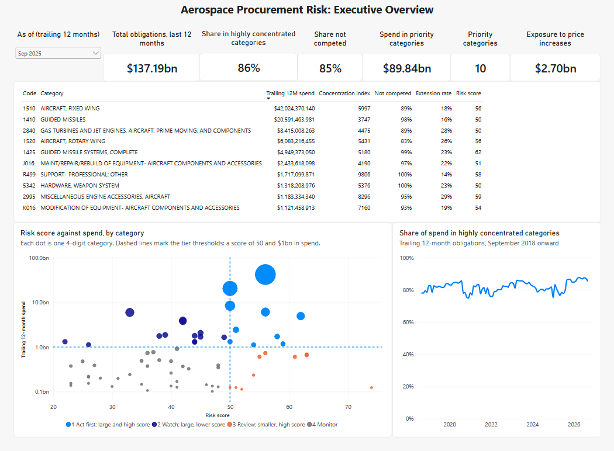
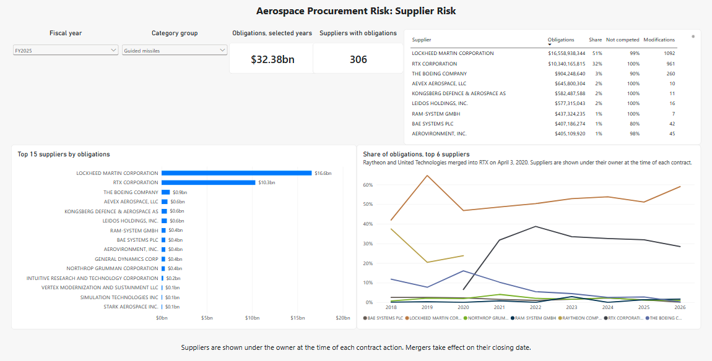
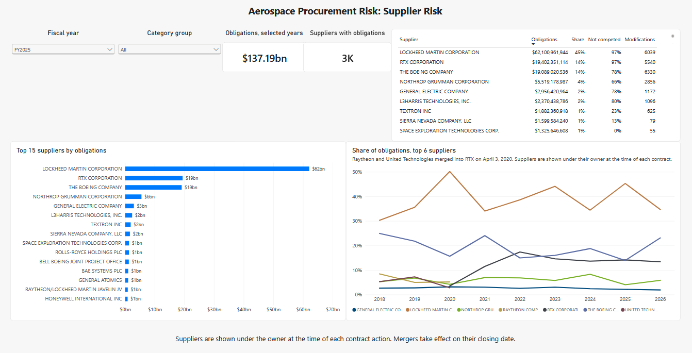
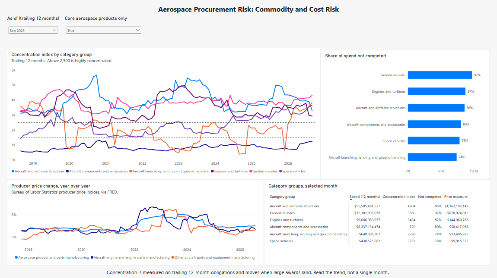
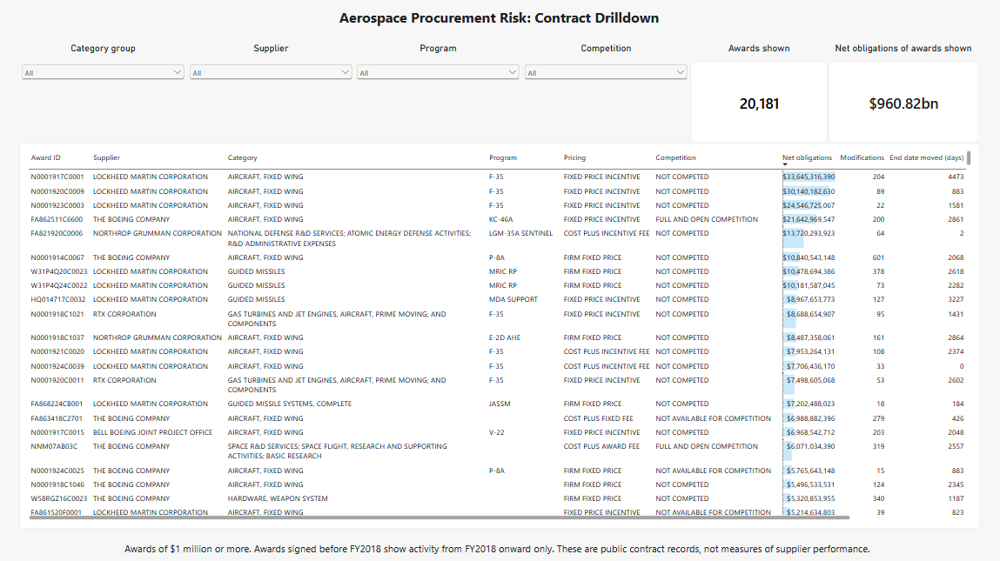

# Aerospace Procurement Risk & Supplier Concentration Analytics

Where are U.S. aerospace procurement dollars most exposed to supplier concentration, limited competition, contract changes and rising prices, and where should a procurement team look first?

This project answers that from public data: 38 million Department of Defense and NASA contract transactions (FY2018 to September 2026), narrowed to 1.57 million aerospace transactions worth $988 billion, modelled in PostgreSQL with dbt and presented in a four-page Power BI report.



## Key findings

Figures are for the 12 months to September 2025, the latest complete fiscal year, unless stated.

1. **Most aerospace spend sits in highly concentrated categories.** 86% of trailing obligations ($118 billion of $137 billion) were in category groups with a concentration index above 2,500, the conventional threshold for a highly concentrated market. In FY2018 the share was 82%; it has ranged between roughly 75% and 88% since.
2. **Ten categories hold two thirds of the money.** Ten 4-digit product and service categories account for $89.8 billion (65%). Each has a risk score of 50 or more and at least $1 billion in spend.
3. **Competition is the exception.** 85% of trailing obligations were on awards not competed, about the same as FY2018 (84%).
4. **Fixed-wing aircraft is the single largest exposure.** $42.0 billion, a concentration index of 5,997, and 89% not competed. Lockheed Martin held 68% of the aircraft and airframe group.
5. **Missile spend nearly doubled while staying almost entirely uncompeted.** Guided missile obligations rose from $17.9 billion in FY2018 to $32.4 billion, 97% not competed. Lockheed Martin and RTX held 83% of FY2025 missile obligations (51% and 32%).
6. **The 2020 Raytheon and United Technologies merger is visible in the data.** Raytheon held 20% to 37% of missile obligations as an independent company in FY2018 to FY2020. The merged RTX has held 28% to 39% since FY2021.
7. **Price exposure is modest at current inflation.** Applying each category's producer price change to its trailing spend gives about $2.7 billion of exposure, mostly in aircraft ($1.16 billion) and missiles ($0.68 billion). The engine index rose about 6% a year at its 2022 to 2023 peak, so this measure matters more when prices accelerate.



## Recommendations

These follow from the indicators above. They identify where to look, not what the cause is.

1. **Start sourcing reviews with the ten priority categories,** in order of spend: fixed-wing aircraft, guided missiles, aircraft gas turbines and jet engines, rotary-wing aircraft and complete missile systems cover $82 billion between them.
2. **Look for competition below the system level.** Complete missile systems have 11 active suppliers and a concentration index of 5,180, while missile components have about 90. Component and subsystem buys are where a second source is most practical.
3. **Track schedule movement alongside spend.** In engine accessories and gas turbines, 28% to 29% of contract modifications pushed an award's end date out by more than 30 days. These categories warrant schedule reporting even where the dollars are smaller.
4. **Watch price exposure before major negotiations.** Exposure is small at today's inflation, but the 2022 to 2023 spike shows how quickly it grows. Checking the relevant producer price index before pricing large follow-on awards is a low-cost safeguard.

## Dashboard

A four-page Power BI report built on the exported marts. A [PDF of all four pages](dashboards/aerospace_procurement_risk.pdf) and screenshots are below. The report file itself is not in the repository because it embeds the data.

| Page | Question it answers |
|---|---|
| Executive Overview | Where is the exposure, and is it growing? |
| Supplier Risk | Who holds the spend, and how has that changed? |
| Commodity and Cost Risk | Which categories are concentrated, uncompeted or exposed to price increases? |
| Contract Drilldown | Which awards sit behind a number? Each row links to its public record. |





## Data sources and limitations

- [USAspending.gov](https://www.usaspending.gov) contract transactions for DoD and NASA, FY2018 to early September 2026, from the yearly award archive files.
- [FRED](https://fred.stlouisfed.org) producer price indices from the Bureau of Labor Statistics: aerospace products and parts, aircraft engines and parts, and other aircraft parts.
- **Scope:** product categories for missiles, aircraft, aircraft components, launch and ground equipment, space vehicles and engines, plus any contract with an aerospace manufacturing industry code (NAICS 3364xx), which adds R&D and sustainment work.
- **These are risk indicators, not performance ratings.** The data shows what the government obligated and how contracts changed. It contains no delivery, quality or cost-overrun records.
- **Supplier names needed cleaning.** The source mislabels some parent companies, restates history for others, and splits companies across several identifiers. Twenty-nine dated ownership rules resolve the largest cases; suppliers under $50 million a year were not reviewed. See [ownership checks](docs/sample_findings.md).
- **Concentration moves with large awards.** A single large award can shift a category's 12-month index by over 1,000 points, so trends matter more than single months.
- **FY2026 is partial,** ending in early September 2026.

## How it works

```
USAspending yearly archives + monthly API     FRED price indices
                 |                                    |
        Python ingestion: 38M rows read, 1.57M in-scope rows loaded
                 |
        PostgreSQL raw tables (Docker)
                 |
        dbt: staging -> star schema -> monthly marts, 53 tests
                 |
        CSV export -> Power BI

All of it is orchestrated as Dagster assets.
```

- **Ingestion** (`ingestion/`): downloads yearly archive files for the backfill and monthly files through the API for incremental loads, filters to scope while loading, and records every load. Reloading a file replaces its rows.
- **Cleaning** (`dbt/models/staging`): types every field, removes duplicates that appear in overlapping files, and applies dated supplier ownership so a company keeps its own name until its merger closing date.
- **Warehouse** (`dbt/models/warehouse`): a star schema with six dimensions and a transaction fact table, with relationship tests to every dimension.
- **Marts** (`dbt/models/marts`): trailing 12-month concentration (HHI, top-four share), competition, modification and schedule indicators, price exposure, and a composite risk score. Tests reconcile the marts to the fact table to the cent.
- **Orchestration** (`orchestration/`): Dagster defines every step as an asset. Contract data is partitioned by fiscal year, so the backfill is a nine-partition run and any single year can be reloaded on its own. dbt models and their tests appear as assets and checks, a `full_refresh` job rebuilds everything downstream of the loaded data, and a monthly schedule reloads the current fiscal year on the 8th, after USAspending refreshes its files.
- **SQL techniques** used where the analysis needed them: window functions for de-duplication, ranking, lagged end dates and rolling sums; range-based trailing windows; date-effective joins for ownership; and percentile ranks for the score.

### Risk score

An equal-weighted average of five percentile ranks among categories with at least $100 million in trailing spend: concentration, share not competed, modifications per new award, schedule extension rate, and year-over-year price change. Priority categories are those with a score of 50 or more and at least $1 billion in spend. Full definitions are in the [business case](docs/business_case.md).

## Documentation
- [Business case, scope and KPI definitions](docs/business_case.md)
- [Data model](docs/data_model.md)
- [Architecture](docs/architecture.md)
- [Data profile and ownership checks](docs/sample_findings.md)
- [Power BI build guide](docs/power_bi_build_guide.md)

## Stack
Python (pandas, SQLAlchemy, requests), PostgreSQL, dbt, Dagster, Docker, Power BI.

## Run locally
```
cp .env.example .env            # then set a password
docker compose up -d            # PostgreSQL on port 5433
python -m venv .venv && source .venv/bin/activate
pip install -r requirements.txt
python ingestion/backfill_archive.py --start-fy 2018 --end-fy 2026   # yearly files, about 10 GB
python ingestion/load_raw.py data/raw/archive                         # in-scope rows into PostgreSQL
python ingestion/fetch_price_index.py                                 # producer price indices from FRED
set -a; source .env; set +a
cd dbt && dbt build --profiles-dir . && cd ..                         # warehouse, marts and tests
python ingestion/export_powerbi.py                                    # CSVs for the Power BI report
```
Or run the same steps through Dagster, which shows the asset graph and run history at http://127.0.0.1:3000:
```
dagster dev -m orchestration.definitions
```
`ingestion/bulk_download.py` pulls single months through the USAspending API for incremental loads.
